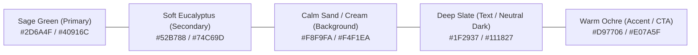

# Dokumen Panduan Reka Bentuk UI/UX, Skema Warna & Struktur Laman Web Sakeenah Medicare

Dokumen ini menggariskan garis panduan visual, seni bina maklumat (*information architecture*), skema warna terapeutik, tipografi, struktur halaman (wireframe hierarchy), dan komponen UI untuk pembangunan semula laman web **Sakeenah Medicare** (`sakeenahmedicare.net`).

---

## 1. Konsep & Falsafah Reka Bentuk (Design Philosophy)

* **Tema Teras:** *Tranquil, Empathetic & Professionally Clinical* (Ketenangan, Empati & Profesionalisme Klinikal).
* **Objektif Visual:** 
  * Pelawat yang mencari khidmat psikologi kebiasaannya berada dalam situasi tertekan, cemas, atau letih emosi. Reka bentuk mesti **menenangkan deria**, tidak serabut, tiada animasi agresif, dan mudah dilayari (*frictionless*).
  * Menyeimbangkan imej perubatan moden berwibawa dengan aura kehangatan (*warmth & safe space*).

---

## 2. Skema Warna Rasmi (Color Palette & Tokens)

Palet warna ini diilhamkan daripada elemen alam semula jadi (alam kehijauan lembut dan tona tanah hangat) untuk mencetuskan rasa damai (*sakeenah* / ketenangan jiwa).

### Kod Warna (Tailwind & CSS Variables):

| Peranan Warna | Nama Warna | Kod Hex | Penggunaan dalam UI |
| :--- | :--- | :--- | :--- |
| **Primary (Brand)** | Forest / Sage Deep | `#2D6A4F` | Header, butang utama (Primary CTA), ikon penting, tajuk penegasan. |
| **Primary Light** | Soft Sage | `#52B788` | Hover state butang, background lencana (*badges*), sempadan aktif (*focus border*). |
| **Secondary** | Muted Ocean Teal | `#2A6F97` | Sub-seksyen perkhidmatan, pautan teks (*inline links*), infografik. |
| **Accent / Warm CTA** | Terracotta / Warm Clay | `#E07A5F` | Butang tempahan segera (*Book Session Now*), penyerlah diskaun/pakej penting. |
| **Surface / Light BG** | Serene Pearl / Milk White | `#FBFBFB` | Latar belakang utama laman web (mengelakkan warna putih silau `#FFFFFF`). |
| **Card / Box BG** | Warm Sand Tint | `#F4F1EA` | Kad perkhidmatan, ruang ulasan testimoni, latar belakang form input. |
| **Text Dark (Headings)** | Deep Charcoal | `#111827` | Tajuk H1, H2, H3 (kontras tinggi, mesra kebolehcapaian WCAG AAA). |
| **Text Muted (Body)** | Slate Grey | `#4B5563` | Perenggan teks biasa, penerangan perkhidmatan, kapsyen. |
| **Alert / Crisis** | Gentle Rose Red | `#DC2626` | Sepanduk talian krisis (Talian HEAL/Befrienders) & mesej ralat borang. |

---

## 3. Tipografi (Typography Hierarchy)

Gabungan fon serif moden yang mesra untuk tajuk (memberi aura empati dan kematangan) dan sans-serif yang bersih untuk teks biasa (kebolehbacaan optimum).

* **Tajuk (Headings - H1, H2, H3):** **`Plus Jakarta Sans`** atau **`Outfit`** / **`Fraunces`**
  * Memberikan kesan profesional, elegan, dan kontemporari.
* **Teks Biasa (Body Text & Forms):** **`Inter`** atau **`Plus Jakarta Sans`**
  * Sangat mudah dibaca pada pelbagai saiz skrin telefon pintar, keratan perenggan yang kemas.

### Skala Tipografi:
* **Display H1 (Hero Title):** `text-4xl md:text-5xl lg:text-6xl font-bold tracking-tight text-neutral-900`
* **H2 (Section Header):** `text-2xl md:text-3xl font-semibold text-neutral-800`
* **H3 (Card Title):** `text-xl font-medium text-neutral-800`
* **Body Regular:** `text-base text-neutral-600 leading-relaxed`
* **Small / Caption:** `text-sm text-neutral-500`

---

## 4. Seni Bina Maklumat & Struktur Laman Web (Sitemap Architecture)

Penstrukturan semula membuang URL templat lama (`/psychologist-selangor/...`) dan menggantikannya dengan struktur hierarki yang bersih:

```mermaid
flowchart TD
    Home["Laman Utama (Home)<br>/"]
    
    About["Tentang Kami<br>/tentang-kami"]
    About --> Vision["Visi & Misi"]
    About --> Location["Klinik Cyberjaya & Fasiliti"]
    
    Services["Perkhidmatan<br>/perkhidmatan"]
    Services --> S1["Penilaian Diagnostik (ADHD, ASD, IQ)"]
    Services --> S2["Psikoterapi Individu (Anxiety, Depression, Trauma)"]
    Services --> S3["Terapi Pasangan & Keluarga (Marriage/Family)"]
    Services --> S4["Terapi Kanak-Kanak (Speech & Occupational Therapy)"]
    Services --> S5["Program Korporat & EAP"]
    
    Team["Pakar & Ahli Pasukan<br>/pasukan-pakar"]
    Team --> ProfileDetail["Profil Individu Pakar<br>/pasukan-pakar/{slug}"]
    
    Screener["Saringan Kendiri (Quiz)<br>/ujian-saringan"]
    
    Booking["Sistem Tempahan Temu Janji<br>/tempah-sesi"]
    Booking --> StepService["Pilih Khidmat & Mod (Online / In-Person)"]
    Booking --> StepDoctor["Pilih Pakar & Slot Kalendar"]
    Booking --> StepIntake["Borang Pra-Sesi (Intake Form)"]
    Booking --> StepPayment["Bayaran Deposit (FPX/Kad)"]
    Booking --> StepConfirm["Pengesahan & Resit"]

    Resources["Hab Edukasi & Blog<br>/artikel"]
    Contact["Hubungi Kami<br>/hubungi-kami"]
    
    Home --> About
    Home --> Services
    Home --> Team
    Home --> Screener
    Home --> Booking
    Home --> Resources
    Home --> Contact
```

---

## 5. Struktur Setiap Halaman Utama (Page Structure & Wireframe Blueprint)

### 5.1 Halaman Utama (Homepage - `/`)
1. **Top Emergency Bar (Crisis Hotline):**
   * Amaran ringkas dan lembut: *"Jika anda atau insan tersayang dalam krisis kecemasan, hubungi Talian HEAL di 15555 atau Befrienders di 03-7627 2929 serta-merta."*
2. **Navbar (Header Bersih):**
   * Logo Sakeenah Medicare, Menu navigasi (Perkhidmatan, Pakar, Saringan Kendiri, Artikel, Lokasi), dan butang penyerlah: **"Tempah Temu Janji" (CTA)**.
3. **Hero Section:**
   * **Tajuk:** *"Ruang Selamat Menuju Ketenangan Jiwa & Pemulihan Diri."*
   * **Sub-tajuk:** Pusat Psikologi & Kesejahteraan Emosi Cyberjaya yang menawarkan terapi klinikal untuk kanak-kanak, individu, pasangan, dan keluarga.
   * **Dual Call-to-Action:** Butang `[Tempah Sesi Temu Janji]` & Butang `[Ujian Saringan Pantas DASS-21]`.
   * **Social Proof / Trust Badges:** Nombor pendaftaran berlesen (KBM, MAHPC), statistik sesi berjaya, penarafan Google Review (4.9+ Stars).
4. **Interactive Therapy Finder (Modul "Apakah Bantuan Yang Anda Cari?"):**
   * Kad pilihan bergambar:
     * *Untuk Diri Sendiri (Stres, Anxiety, Kemurungan)*
     * *Untuk Anak-Anak (Perkembangan Lewat, Autisme, ADHD, Speech Delay)*
     * *Untuk Hubungan & Perkahwinan (Komunikasi, Konflik Suami Isteri)*
     * *Untuk Organisasi / Korporat (Bengkel & Khidmat EAP)*
5. **Senarai Pakar Klinikal & Kaunselor (Meet Our Specialists):**
   * Grid profil ringkas dengan gambar berwibawa, kelayakan, bahasa pengantar, dan butang pantas *"Pilih Slot Pakar Ini"*.
6. **Ujian Saringan Kendiri Interaktif (Teaser Quiz Widget):**
   * Widget interaktif DASS-21 ringkas untuk menarik minat pelawat mengukur tahap emosi mereka dengan serta-merta.
7. **Suasana Klinik (Our Safe Space in Cyberjaya):**
   * Gambar sebenar ruang terapi di Shaftsbury Square Cyberjaya (bilik konsultasi mesra kanak-kanak, ruang terapi tenang dan privasi terjamin).
8. **Ulasan Klien & Testimoni Tertapis (Client Experiences):**
   * Testimoni tanpa mendedahkan identiti peribadi klien bagi menjaga kerahsiaan etika perubatan.
9. **Soalan Lazim (FAQ Accordion):**
   * Berapa kadar bayaran sesi? Adakah maklumat saya dirahsiakan? Bagaimana perbezaan antara kaunselor dan psikologis klinikal?
10. **Footer Lengkap:**
    * Peta lokasi Cyberjaya, waktu operasi klinik (Isnin - Sabtu), nombor WhatsApp rasmi, pautan media sosial, dan pautan Telegram Sakeenah Community.

---

### 5.2 Aliran Sistem Tempahan (Booking Funnel - `/tempah-sesi`)

Aliran 4 langkah mudah (*Step-by-Step Multi-step Form*):
1. **Langkah 1: Jenis Khidmat & Lokasi**
   * Pilih mod: Bersemuka di Klinik (Cyberjaya) ATAU Tele-Terapi (Panggilan Video Google Meet).
   * Pilih jenis terapi: Terapi Individu (Dewasa), Kanak-Kanak / Terapi Pertuturan, Terapi Pasangan.
2. **Langkah 2: Pilih Pakar & Tarikh/Masa**
   * Paparan ketersediaan kalendar terus. Slot masa yang telah ditempah akan dikaburkan (*disabled*).
3. **Langkah 3: Maklumat Klien & Borang Saringan Asas (Intake Form)**
   * Nama penuh, nombor telefon WhatsApp, alamat emel, umur, dan ringkasan sebab ingin memulakan terapi.
   * Pengesahan Terma Privasi & Persetujuan Berpengetahuan (*Informed Consent*).
4. **Langkah 4: Bayaran Deposit Komitmen & Pengesahan**
   * Pilihan gerbang pembayaran (FPX Bank Transfer / DuitNow QR / Kad).
   * Notifikasi pengesahan dihantar secara automatik ke WhatsApp dan emel klien beserta pautan kalendar (.ics).

---

### 5.3 Modul Saringan Kendiri (Self-Assessment Screener - `/ujian-saringan`)
* Menggunakan skala standard psikologi seperti **DASS-21** (Depression, Anxiety, Stress Scale).
* Soalan dipaparkan dalam bentuk kad interaktif satu demi satu dengan bar kemajuan (*progress bar*).
* Paparan skor akhir dengan visualisasi graf tahap (Normal, Ringan, Sederhana, Teruk).
* Tindakan seterusnya: Saranan langkah penjagaan diri dan butang cadangan pakar yang sesuai untuk konsultasi lanjut.

---

## 6. Garis Panduan Komponen UI (Design System Components)

1. **Butang (Buttons):**
   * *Primary Button:* Latar belakang Sage Green (`#2D6A4F`), teks putih, bucu bulat sederhana (`rounded-xl` / `rounded-full`), efek bayang halus (`shadow-sm hover:shadow-md`).
   * *Accent Booking Button:* Latar belakang Warm Terracotta (`#E07A5F`), teks putih, hover tona lebih gelap.
   * *Secondary / Outline Button:* Garisan sempadan kelabu lembut (`border border-neutral-300 hover:border-emerald-600`).
2. **Kad (Cards):**
   * Menggunakan bucu bulat selesa (`rounded-2xl`), sempadan nipis lembut (`border border-neutral-200/60`), padding selesa (`p-6` atau `p-8`), dan latar belakang putih bersih atau kelabu krim hangat (`bg-white` / `bg-[#FAF8F5]`).
3. **Borang Input (Forms):**
   * Input saiz selesa (`py-3.5 px-4`), teks jelas, border kelabu lembut (`border-neutral-300`), ring fokus berwarna sage (`focus:ring-2 focus:ring-emerald-500/20 focus:border-emerald-600`).
4. **Ikonografi (Icons):**
   * Gunakan set ikon garis lembut seperti **Lucide Icons** atau **Heroicons** dengan ketebalan sederhana (*stroke-width: 1.5px*), mengelakkan ikon bersegi tajam atau bersudut agresif.
